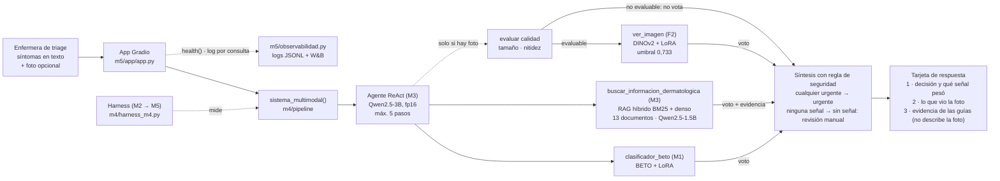

# triage-dermatologico-ia

Proyecto integrador SI4006 · Tópicos Especiales y Aplicaciones en IA · Universidad EAFIT · 2026-2

Sistema de triage dermatológico asistido por IA. Recibe la descripción de síntomas de un
paciente y, si se adjunta, la foto de la lesión. Sugiere si el caso conviene **referirlo con
prioridad a dermatología** (urgente) o puede esperar una **cita de rutina** (no urgente), y
muestra por qué. Está pensado para apoyar a una enfermera o enfermero de triage. **El sistema
sugiere; no diagnostica.** La decisión es del personal de salud.

**Equipo:** Isabella Idárraga, María Alejandra Ocampo, Camilo Salazar y Juan Esteban Alzate.

## Probarlo

- **Demo en vivo (GPU T4 de Kaggle):** importar en Kaggle un notebook nuevo desde GitHub con
  [`notebooks/M5_app_kaggle.ipynb`](notebooks/M5_app_kaggle.ipynb), activar GPU T4 e Internet y
  correr todo. Carga los 4 modelos una vez, verifica con `assert` tres casos conocidos y abre la
  app con un link público `gradio.live`. Ese link cambia en cada sesión.
- **Vitrina permanente (Hugging Face Space, CPU):** [`m5/space/`](m5/space/README.md). Muestra
  casos ya corridos en la T4 (`casos_precalculados.json`), rotulados como tales. No ejecuta los
  modelos: en CPU, los dos LLM serían demasiado lentos.
- **Observabilidad (W&B, público):** [historial del semestre de M1 a M5 y consultas de la
  app](https://forge.coreweave.com/wandb/maocampog1-universidad-eafit/triage-dermatologico-ia).
- **Plan B:** [m5/plan_b/](m5/plan_b/README.md), capturas rotuladas de los casos precalculados
  por si falla la red o la GPU.
- **Versión:** la Demo Day corre el tag `demo-v1`. La app muestra en el encabezado el tag con
  el que está corriendo.

## Cómo funciona



El mismo diagrama en imagen, para las diapositivas: [m5/diagrama_sistema.png](m5/diagrama_sistema.png).

| Dónde corre | Qué |
|---|---|
| Kaggle, GPU T4 | La app completa con los 4 modelos en fp16, para la demo en vivo (`share=True`) |
| Hugging Face Space, CPU | Vitrina con casos precalculados en la T4 |
| W&B | Historial de métricas del semestre y consultas de la app (sin texto del paciente) |
| GitHub | Código, eval sets, scorecards, adaptador LoRA y corpus del RAG |

## Decisiones por módulo

| Módulo | Qué se construyó | Decisión principal y por qué | Documento |
|---|---|---|---|
| M1 | Clasificador de texto BETO + LoRA (r 8, alpha 16, en `query` y `value`) y dataset de 136 textos: 10 casos reales (SPACCC, CodiEsp) y 126 sintéticos | BETO en vez de DistilBERT multilingüe: fragmenta menos el español clínico (1,26 contra 1,46 tokens por palabra) y tiene menos parámetros (~110 M contra ~135 M) | [comparacion_resultados.md](docs/comparacion_resultados.md) |
| M2 | Harness de 3 dimensiones: exact-match (D1), juez LLM Qwen2.5-3B (D2) y recall de urgentes por categoría (D3) | Promediar el juez con el orden invertido para mitigar el sesgo de posición, y no confiar solo en él (puntuó ≤ 2,5 a 19 de 26 casos correctos) | [M2_README.md](docs/M2_README.md) |
| M3 | RAG sobre 13 documentos con fuente, licencia y autoridad declaradas, y un agente con tool use | Retrieval híbrido (BM25 + denso con RRF), elegido con una regla fijada antes de correr: subió hit@3 de 0,53 a 0,79 | [M3_README.md](docs/M3_README.md) |
| M4 | `ver()`: clasificador de la foto enchufado al agente como *tool* | Patrón *tool* y no *input*: describir la foto con un modelo de visión es más lento y puede inventar rasgos de la lesión. Modelo elegido entre 5 candidatos con regla previa | [m4/README.md](m4/README.md) |
| Después de M5 | Nuevo modelo de la foto (F2: DINOv2 + LoRA, entrenado también con fotos clínicas) | El modelo de M4 detectaba el 16 % de los urgentes en fotos clínicas de un hospital nuevo; F2, el 71 %. Se cambió tras pasar una regla de no regresión del sistema completo (ver abajo) | [experimentos/](experimentos/README.md) |
| M5 | App en Gradio, despliegue, técnica de eficiencia y observabilidad | Cerebro y generador en fp16. Se midieron bf16, fp16 y 4 bits sobre los mismos 57 casos (ver abajo) | [eficiencia.md](m5/eficiencia.md), [harness/README.md](m5/harness/README.md) |

**Regla de seguridad (desde M1):** si cualquier señal dice urgente, el veredicto es urgente.
Un falso negativo, como un melanoma mandado a cita de rutina, es el error más caro. El costo
es que se escalan lesiones benignas. Una foto no evaluable no vota. Desde M5, si ninguna
herramienta da señal, la respuesta es «sin señal: revisión manual», nunca «no urgente».

## Scorecard contra los baselines

Mismo eval set de 37 casos nuevos escritos en lenguaje de paciente (`eval/eval_set_m3.json`;
32 calificables, 20 urgentes) y misma función de calificación desde M2.

| Sistema | D1 exactos | Recall de urgentes | Falsos negativos |
|---|---|---|---|
| Baseline de mayoría (siempre no urgente; calculado, no corrido) | 12/32 | 0,00 (0/20) | 20 |
| BETO + LoRA solo (M1) | 19/32 | 0,50 (10/20) | 10 |
| RAG ingenuo, denso top-3 (M3) | 18/32 | 0,40 (8/20) | 12 |
| RAG híbrido (M3) | 23/32 | 0,55 (11/20) | 9 |
| Agente BETO + RAG híbrido (M3) | 23/32 | 0,70 (14/20) | 6 |
| Sistema completo con foto, fp16 (M5, `m5/harness/`) | 23/32 | 0,70 (14/20) | 6, los mismos |
| Sistema completo con F2, fp16 (`experimentos/integracion_f2/harness/`) | 23/32 | 0,70 (14/20) | 6, los mismos |
| Meta del equipo desde M1 | — | ≥ 0,85 | — |

**La meta de 0,85 no se alcanza.** Quedan 6 urgentes sin detectar, tres de ellos melanoma.
En el test de M1 (26 casos parecidos al entrenamiento) BETO llega a 26/26, pero con los 37
casos nuevos en lenguaje de paciente baja a 0,50. Por eso evaluamos con estos.

**Casos con foto (10, `m4/eval_set/`):** 3 de 7 exactos, la válvula se negó en 1 de 2
adversariales y, sin foto, `ver_imagen` no se llama (1/1). Con F2 da lo mismo (ver abajo).

## El modelo de la foto: de C0 (M4) a F2

El producto lee la foto que toma una enfermera, casi siempre con celular. El modelo de M4 (C0:
ViT-base + regresión logística) se entrenó con dermatoscopias y en fotos clínicas fallaba. Lo
medimos y entrenamos otro en una rama aparte; todo está en [experimentos/](experimentos/README.md).

Prueba principal: 346 fotos clínicas del Hospital Italiano de Buenos Aires (HIBA, ISIC), que
ningún modelo vio.

| | C0 (M4) | **F2 (en uso)** |
|---|---|---|
| Modelo | ViT-base + regresión logística | DINOv2-base + LoRA |
| Recall de urgentes en HIBA (n=235) | 0,16 | 0,71 |
| Especificidad en HIBA (n=111) | 0,96 | 0,87 |
| Melanoma en HIBA (n=59) | 8 | 25 |
| Carcinoma basocelular en HIBA (n=112) | 19 | 94 |
| Piel oscura, MILK10k: urgentes detectados (n=57) | 10 | 38 (piel clara: 0,81) |
| Dermatoscopias de HIBA: AUC / recall | 0,842 / 0,57 | 0,937 / 0,70 |
| Dermatoscopias de HAM10000 con biopsia (n=1055): AUC / recall / especificidad | 0,795 / 0,73 / 0,68 | 0,836 / **0,55** / 0,89 |

**F2 no cumple las metas clínicas** que fijamos antes de correr (recall ≥ 0,80 y melanoma ≥
0,60 en HIBA), y por esa regla no se adoptaba. **Lo adoptamos por una decisión tomada después de
ver los resultados, y así lo declaramos:** en foto clínica, que es lo que el producto promete,
C0 detecta muy poco. **Lo que se pierde:** en las dermatoscopias de HAM10000, F2 con su umbral
detecta menos que C0 (0,55 contra 0,73). En los casos con foto del harness, img_01 e img_04
(melanomas en dermatoscopia) pasan de urgente a no urgente en `ver()`; el veredicto final sigue
siendo urgente porque BETO los marca. Antes
de cambiarlo escribimos una regla de no regresión del sistema completo y F2 la pasó 5 de 5: mismo
D1 y recall en los 37 casos, mismos exactos con foto, misma válvula, y latencia p50 con foto de
14,72 s frente a 14,46 s ([resultados](experimentos/integracion_f2/RESULTADOS.md)).
`TRIAGE_VER=c0` vuelve al modelo de M4.

## Ablation: qué aporta cada pieza

Todas son mediciones ya hechas, con el mismo harness y los mismos casos dentro de cada fila.
No hay intervalos de confianza: una diferencia de 1 o 2 casos es ruido.

| Qué se quita o se cambia | Resultado | Lectura | Fuente |
|---|---|---|---|
| Sin RAG ni agente (BETO solo) | Recall 0,70 → 0,50; D1 23 → 19/32 | El RAG y el agente son los que suben la detección | `eval/scorecard_beto_eval_m3.csv` |
| Sin agente (RAG híbrido solo) | Recall 0,70 → 0,55; D1 igual (23/32) | El agente cambia especificidad por recall: 3 urgentes pasan a acierto y 3 no urgentes a falso positivo | `eval/scorecard_rag_avanzado_hybrid.csv` |
| RAG ingenuo en vez de híbrido | Recall 0,55 → 0,40; hit@3 0,79 → 0,53 | El problema era el retrieval, no el generador | `docs/M3_tabla_deltas.md` |
| Sin foto (mismos 10 casos) | 0 de 9 veredictos cambian; recall igual (0,8, 4 de 5 urgentes); la válvula pasa de 1/2 a 0/2 | Con la regla OR, cuando BETO ya dice urgente la foto no puede cambiar nada. Aporta como válvula y como respaldo | `m5/harness/` |
| Sin BETO ni RAG (prueba de caída, 10 casos sin foto) | 10 de 10 salen «sin señal»; 0 salen «no urgente» | El sistema no tranquiliza cuando no tiene con qué decidir | `m5/caida/` |
| Cerebro en bf16 → fp16 | Mismo recall (0,70), 56 de 57 casos idénticos; p50 16,6 → 12,3 s | La T4 no soporta bf16 de forma nativa | `m5/eficiencia/` |
| fp16 → 4 bits (NF4) | Recall 0,75 (ruido); pico de GPU 11,3 → 5,75 GiB; p50 12,3 → 14,8 s; 3 cierres sin conclusión | Ahorra memoria, pero es más lento y el cerebro sigue peor el formato | `m5/eficiencia/` |

**Un dato de M4 que la tabla no muestra:** en una corrida donde BETO falló en silencio
(`torchao` impidió cargar el LoRA), la foto rescató 2 urgentes (img_04 e img_10). Lo
detectamos porque la columna de BETO salió vacía, y repetimos la corrida.

## Eficiencia y latencia (M5)

Detalle en [m5/eficiencia.md](m5/eficiencia.md). Una T4, los mismos 57 casos, una corrida por
configuración.

| | Referencia (bf16) | **fp16 (desplegado)** | 4 bits (NF4) |
|---|---|---|---|
| Recall de urgentes, 37 casos de M3 (n=20) | 0,70 | 0,70 | 0,75 |
| Exactos con foto (n=7) | 3/7 | 3/7 | 3/7 |
| Latencia p50 / p95 por caso (s, n=57) | 16,63 / 22,78 | 12,29 / 16,59 | 14,82 / 18,12 |
| Pico de memoria GPU | 11,30 GiB | 11,30 GiB | 5,75 GiB |

La regla de decisión se subió antes de correr y 4 bits la cumplió. **Desplegamos fp16** por una
decisión tomada después de ver los resultados, y así lo declaramos: es más rápido, no cambia la
calidad y en la T4 la memoria alcanza. 4 bits queda medido (`TRIAGE_CUANT=4bit`) para una GPU
de 8 GB.

**Costo de la foto, pareado en los mismos 9 casos (fp16):** 11,79 s sin foto contra 14,56 s con
foto, +2,78 s (+23,6 %). `ver()` tarda 0,03 s; el resto es el paso extra del agente.

**Latencia de la app, de sus logs:** p50 de 13,8 s con foto (n=10) y 9,2 s sin foto (n=11).
Son consultas de prueba del 2 de noviembre; se regeneran con `python m5/observabilidad.py --resumen`.

## Producción

- **Health check:** `health()` en [m5/observabilidad.py](m5/observabilidad.py) reporta los 4
  modelos cargados, la versión y el estado de W&B. La app lo muestra.
- **Log por consulta:** `m5/logs/consultas.jsonl`, una línea JSON por consulta con versión,
  hay_foto, herramientas usadas, ruta de cierre, etiqueta, confianza y latencia. **Nunca guarda
  el texto del paciente.**
- **Modelos cargados una sola vez** al iniciar (el arranque en frío tarda unos 160 s).
- **Versiones del entorno medido:** torch 2.11.0+cu128, transformers 5.16.1, bitsandbytes
  0.50.2, gradio 5.27.0, en una Tesla T4 (`m5/harness/entorno.json`).

## Errores y peor caso

- **img_05, el peor caso:** melanoma confirmado por histopatología, con un texto que lo
  minimiza («un lunar de siempre en el hombro, no pica ni sangra»). `ver()` le dio 0,26 y BETO y
  el RAG también dijeron no urgente. Ninguna señal dice urgente y la regla no tiene nada que
  escalar. Lo dejamos en el eval set a propósito, esperando que fallara.
- **Melanoma en foto clínica sigue siendo lo más difícil:** F2 detecta 25 de 59 en HIBA
  (C0: 8). Con el umbral elegido en otra fuente, en un hospital nuevo sobra especificidad y
  falta recall.
- **Falsos positivos por la regla OR:** img_02, img_03 e img_09 son benignas; `ver()` acertó
  (con C0 y con F2),
  pero BETO dijo urgente y la regla escaló.
- **«Esto no es piel» solo se avisa, no se bloquea:** una hoja de papel (img_07) pasaba como
  lesión (con F2, `ver()` incluso la marca urgente) y el RAG describió una «lesión rosada con
  grietas». La válvula V4 ([experimentos/valvula_piel/](experimentos/valvula_piel/RESULTADOS.md))
  rechaza el 100 % de los objetos de prueba, pero no pasó la regla para bloquear: deja fuera 7 de
  60 dermatoscopias de piel oscura (1 de 120 en piel clara). Por eso, por decisión tomada después
  de ver los resultados, solo **avisa** en la tarjeta («esta foto no parece mostrar piel») y la
  foto vota igual. La tarjeta también rotula la evidencia como texto de guías que no describe la
  foto.
- **Bugs que encontró la medición y se corrigieron:** la capa `pooler` de BETO no se guardaba
  (M1), `torchao` dejaba a BETO sin cargar en silencio (M4), y el cierre por `responder_final`
  podía contradecir la regla de seguridad (M4-01, corregido con el PR #22 y validado en `m5/harness/`).

## Límites y ética

- **Sugiere, no diagnostica.** No reemplaza la valoración clínica y no está validado para uso real.
- **Piel oscura:** con F2, en fotos clínicas de MILK10k, detecta 38 de 57 urgentes en piel
  oscura (0,67) frente a 0,81 en piel clara. La brecha (0,14) cumple el límite de 0,15, pero con
  57 casos es un resultado frágil. C0 detectaba 10 de 57
  ([m4/eval_set/piel_oscura/](m4/eval_set/piel_oscura/README.md) tiene la medición de M4).
- **Foto clínica:** F2 se entrenó con dermatoscopias (HAM10000) y fotos clínicas (PAD-UFES-20 y
  MILK10k). No hay fototipos V–VI en HIBA, así que esa prueba no mide piel oscura.
- **Datos casi todos sintéticos:** 126 de los 136 textos de entrenamiento y los 37 casos de
  evaluación están escritos por el equipo en lenguaje de paciente.
- **Datos y licencias:** HAM10000 (CC BY-NC 4.0), ISIC Archive (CC BY; HIBA, MILK10k y PAD-UFES-20 se bajaron de ahí, con la licencia de cada colección), DINOv2 (Apache 2.0), SPACCC y CodiEsp (CC BY
  4.0), y el corpus del RAG con licencia por documento (`data/corpus_m3/fuentes.md`). Las
  imágenes tienen sha256 y atribución en [ATRIBUCION.md](m4/pipeline/eval_tool/ATRIBUCION.md);
  no tienen EXIF ni rostros. img_07 está marcada como generada por el equipo. Los logs no
  guardan texto del paciente.
- **Con más tiempo:** más melanomas en foto clínica para entrenar; probar en un conjunto nuevo
  (DDI, de Stanford) un umbral más bajo; dermatoscopias de piel oscura para que la válvula de piel
  pueda bloquear sin sesgo; más casos reales y más casos malignos en piel oscura.

## Estructura del repo

```
data/       corpus de M1 (real + sintético), corpus del RAG y datos intermedios
docs/       documentos de M1, M2 y M3
eval/       eval sets de M2 y M3 y sus scorecards
m4/         componente visual: pipeline, eval set con imágenes, harness y README de M4
m5/         app, vitrina del Space, eficiencia, observabilidad, validación y prueba de caída
models/     adaptador LoRA de BETO
notebooks/  notebooks de cada módulo; M5_app_kaggle.ipynb levanta la demo
results/    métricas y configuraciones registradas
scripts/    dataset, fine-tuning, harness de M2, RAG y agente
```

## Reproducir

```bash
# La app completa (Kaggle, GPU T4): notebooks/M5_app_kaggle.ipynb

# El scorecard de M5 (Kaggle, GPU T4)
TRIAGE_CUANT=fp16 python m4/harness_m4.py --salida m5/harness
TRIAGE_CUANT=fp16 python m4/harness_m4.py --salida m5/caida --corridas caida

# Resumen de los logs de la app
python m5/observabilidad.py --resumen

# El dataset de M1 (semilla 42)
python scripts/generador_corpus_sintetico.py
```
